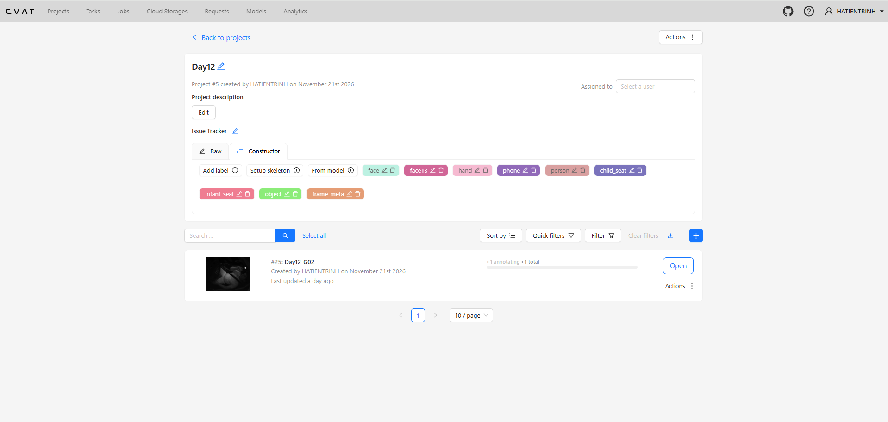
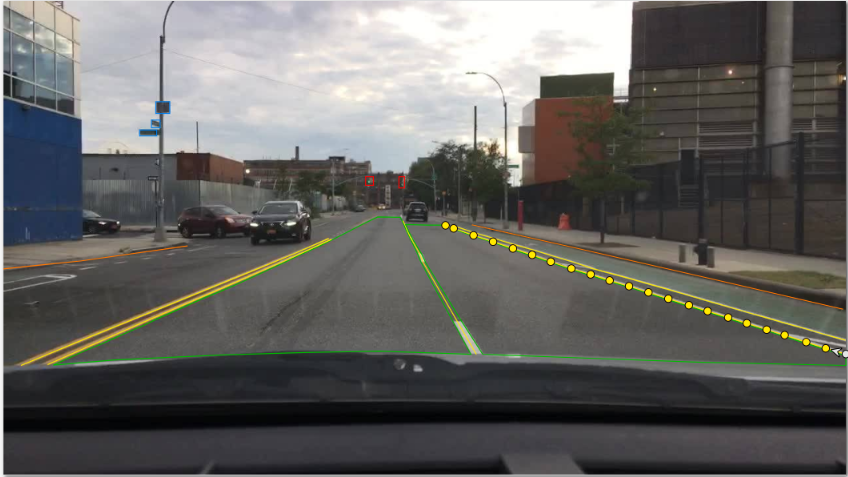
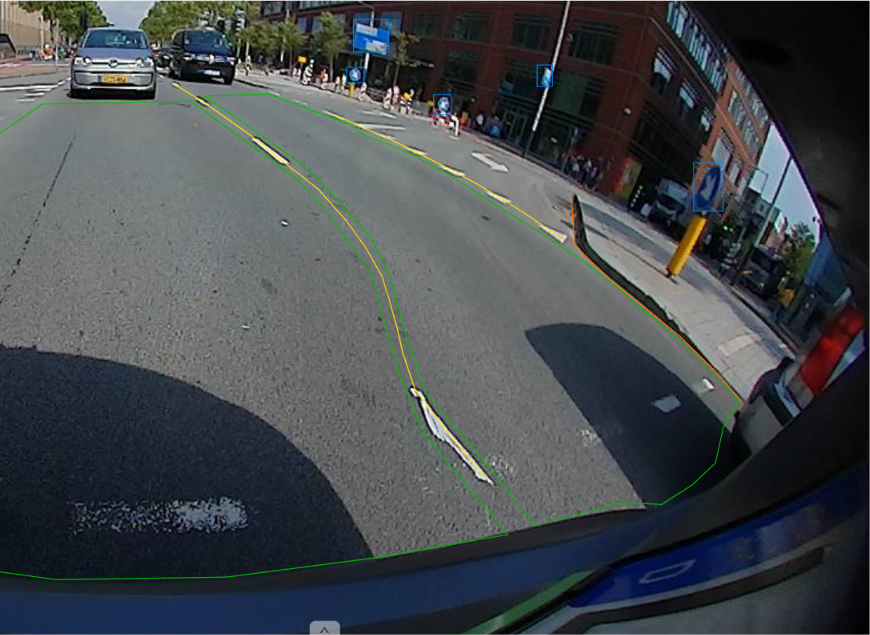

# Báo cáo cá nhân — Ngày 11

Họ tên: Hà Tiến Trịnh Mã học viên: 2A202603154  
Phiên bản CVAT (Help → About): 2.81.0 (CVAT lớp chạy local, `localhost:8080`)  
Guideline: Road v1.0 Lần nộp (`revision` trong manifest): 2  
Thời điểm export (ngày giờ trên CVAT): front 22/11/2026 16:22 (bản sửa), fisheye 22/11/2026 15:08 (giữ nguyên) (giờ VN) Số lần nộp lại sau Rework: 1

## 1. Kiểm project

Đối chiếu phần `<meta>` trong hai file export (job #19 front, job #23 fisheye) với `configs/road_v1_labels.json`:

| Mục                   | Đúng như guideline Road v1.0? | Ghi chú                                                                                                                                                                                     |
| --------------------- | ----------------------------- | ------------------------------------------------------------------------------------------------------------------------------------------------------------------------------------------- |
| 6 label, đúng kiểu    | Đúng                          | lane, road_curb: polyline; crosswalk, drivable: polygon; traffic_light, traffic_sign: rectangle. Không thiếu, không thừa label.                                                             |
| Thuộc tính và giá trị | Đúng                          | Tên thuộc tính, kiểu select và danh sách giá trị khớp hoàn toàn với config. Giá trị mặc định là giá trị đầu danh sách (vd lane `L1 / solid / white / single`), nên phải sửa lại sau khi vẽ. |
| 4 tag ảnh             | Đúng                          | camera, timeofday, weather, source: kiểu Tag, mỗi label có một thuộc tính select `value`.                                                                                                   |

Cách kết thúc polyline trên bản CVAT này: click các điểm trên tâm vạch từ gần ra xa, rồi bấm phím **N** để kết thúc. Sau đó mở **Details** để sửa thuộc tính.  
Cách đặt tag ảnh trên bản CVAT này: dùng công cụ **Tag** ở thanh bên trái, chọn label (camera trước tiên), rồi mở **Details** trong bảng Objects để chọn `value`. CVAT tự điền giá trị đầu danh sách, nên phải kiểm lại từng tag.

## 2. Số lượng đã gán

| Task                         | Ảnh | lane | road_curb | crosswalk | drivable | traffic_light | traffic_sign |
| ---------------------------- | --: | ---: | --------: | --------: | -------: | ------------: | -----------: |
| front                        |  12 |   38 |        13 |         5 |       25 |            42 |           30 |
| front-extra (đã làm 0 / 4)   |   0 |    — |         — |         — |        — |             — |            — |
| fisheye                      |   8 |    8 |        13 |         8 |       10 |             6 |            9 |
| fisheye-extra (đã làm 0 / 4) |   0 |    — |         — |         — |        — |             — |            — |

## 3. Bảng ca khó

| Ảnh           | Nhãn              | Phân vân giữa                                                              | Đã chọn                                 | Lý do                                                                                                                                           |
| ------------- | ----------------- | -------------------------------------------------------------------------- | --------------------------------------- | ----------------------------------------------------------------------------------------------------------------------------------------------- |
| A05           | lane L1/R1        | Vẽ L1/R1 ước lượng theo mép đường / không vẽ                               | Không vẽ                                | Mặt đường không có vạch kẻ nào, mà guideline chỉ gán vạch nhìn thấy. Lint báo QC1-02 nặng, nhưng ca không thấy vạch được miễn theo CHECKPOINTS. |
| A05           | tag weather       | clear / overcast                                                           | overcast                                | Trời xám, không có bóng đổ rõ.                                                                                                                  |
| A04, A09, A11 | lane (vạch đôi)   | Một polyline ở tâm cặp vạch / hai polyline, mỗi polyline trên một nửa vạch | Hai polyline, `kind = double`           | Theo hướng dẫn của coach. Nửa gần xe lấy vị trí kế tiếp (vd L1), nửa ngoài lấy vị trí sau đó (L2), hoặc `other` khi hết vị trí (A09).           |
| A09           | lane R1           | Coi vạch sát lề phải là mép đường (chỉ vẽ road_curb) / gán R1              | Gán R1, `solid / white`                 | Đây là vạch sơn gần xe nhất ở bên phải, nên là R1. Vạch hơi ngả vàng, nên đã ghi vào mục ca mơ hồ của phiếu QC.                                 |
| B07           | lane (camera MVR) | Polyline 3 điểm vì đoạn vạch ngắn / thêm điểm theo cung                    | Thêm điểm theo cung, `position = other` | Fisheye làm cong cả đoạn ngắn; camera hai bên luôn dùng `position = other`.                                                                     |

## 4. Phiếu QC 1 nhận được

Bạn kiểm lô của tôi: tự kiểm (phiếu `hatientrinh-qc1-for-hatientrinh.md`, kiểm trên revision 1) Quyết định nhận được: Release (không có lỗi nặng, lỗi chính 2/90 = 2,2 %)  
| Mã lỗi | Số lỗi | Đồng ý? | Đã sửa? |
| --- | ---: | --- | --- |
| QC1-04 (A09, R1 quá ngắn, chưa sát xe) | 1 | Đồng ý | Đã sửa một phần ở revision 2: R1 bắt đầu sát mép ảnh (1279,686); chưa kéo dài phía xa |
| QC1-07 (A07, vùng lái direct khoét quanh xe phía trước) | 1 | Đồng ý | Đã sửa |

Lần nộp mới: revision 2, chỉ export lại `hatientrinh-front.zip` (sha256 `69e54486…`). `hatientrinh-fisheye.zip` giữ nguyên (sha256 `c9ff3360…`). Bản revision 1 cất ở `r1/` cùng `hatientrinh-manifest-r1.json`.
Ghi chú: ở lần export đầu của bản sửa, R1 của A09 bị đổi nhầm `position` thành L1, và lint báo QC1-02. Tôi đã phát hiện trước khi nộp và sửa lại thành R1.

## 5. Kiểm file export

Kiểm bằng `road_check lint`: cả hai file mở lại được; 20/20 ảnh đủ bốn tag; `contains_images = false`.

| File                    | Mở lại được?             | Số shape ảnh 1 (job / file) | Số shape ảnh 2 (job / file) | Tag camera có trong XML?             |
| ----------------------- | ------------------------ | --------------------------- | --------------------------- | ------------------------------------ |
| hatientrinh-front.zip   | Có (CVAT for images 1.1) | A01: 11 / 11                | A02: 8 / 8                  | Có (`front`)                         |
| hatientrinh-fisheye.zip | Có (CVAT for images 1.1) | B01: 4 / 4                  | B02: 9 / 9                  | Có (`fisheye_front/rear/left/right`) |

Số shape bên "job" lấy từ phần export của chính job đó (job #19, job #23). Số bên "file" là số `road_check lint` đọc được khi mở lại file zip. Hai bên khớp, nên export không làm mất shape.

## 6. Ảnh chụp màn hình

1. Tab Labels của project:
   
2. Một ảnh camera trước đã gán đủ: A04 trên CVAT, có làn (vàng đôi L1/L2, R1 đứt, R2), vùng lái direct/alternative, road_curb, 2 đèn và 3 biển.
   
3. Ảnh fisheye B03 (camera sau) trên CVAT, phóng to đoạn L1 cong theo cung (17 điểm) và L2 (10 điểm).
   
4. Đoạn XML có `<polyline label="lane">` (A01, L1 vạch trắng đứt, trích từ `hatientrinh-front.zip`):
   ```xml
   <polyline label="lane" source="manual" occluded="0" points="109.17,719.47;182.67,657.22;257.80,593.90;284.33,569.78;304.87,554.35;316.57,543.85;332.08,530.65;336.58,526.15;346.30,518.70" z_order="0">
     <attribute name="position">L1</attribute>
     <attribute name="style">dashed</attribute>
     <attribute name="color">white</attribute>
     <attribute name="kind">single</attribute>
   </polyline>
   ```

## 7. Tự đánh giá

Lỗi bạn mắc nhiều nhất hôm nay (theo mã QC1-xx), và cách tránh ở Ngày 20: QC1-11 (polyline trên fisheye quá ít điểm, ở B05 và B07) và QC1-02 (thiếu R1 ở A09). Cách tránh: trên ảnh fisheye, đặt điểm dày ở vòng ngoài; xong mỗi ảnh camera trước, tự kiểm đã có L1 và R1 chưa; chạy `road_check lint` trước khi chuyển job sang completed.  
Nhãn của bạn đi vào model ở đâu? Chọn một lỗi đã sửa và nói nó làm model học sai thế nào: Polyline làn được lấy mẫu thành đích row-anchor (x của vạch ở từng hàng y). Nếu thiếu R1 ở A09, model học rằng ở những hàng đó bên phải xe "không có làn", nên LKA mất biên phải. Polyline 3 điểm ở B07 nối thẳng các điểm thay vì đi theo cung, nên đích x ở các hàng giữa bị lệch khỏi vạch thật và model học sai độ cong trên fisheye.

## 8. (Tùy chọn, buffer) Từ polyline đến đích row-anchor

Kết quả của `python -m road_lab.rowanchor hatientrinh-front.zip --image A01` (lane#5, bắt đầu ở (708,719)):

| y               |          720 |   680 |   640 |   600 |   560 |
| --------------- | -----------: | ----: | ----: | ----: | ----: |
| x của chúng tôi | không có làn | 655.1 | 600.7 | 542.6 | 484.4 |
| x của bạn kia   |              |       |       |       |       |

Trả lời 3 câu:

1. Năm số x đó chính là đích mà một model row-anchor học cho vạch này. Nếu bạn dừng polyline sớm 40 px, hàng nào đổi thành "không có làn"?
2. So với bạn được kiểm (cùng ảnh): ở hàng 720 và hàng 560, hai bạn lệch nhau bao nhiêu pixel? Lệch ở hàng nào ảnh hưởng LKA nhiều hơn (slide 25)?
3. Nếu polyline vẽ từ xa về gần (ngược quy tắc 2), cách tính trên có đổi không? Script nào sẽ gặp khó?
